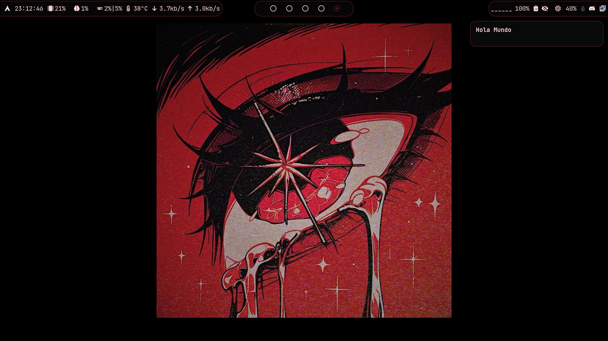
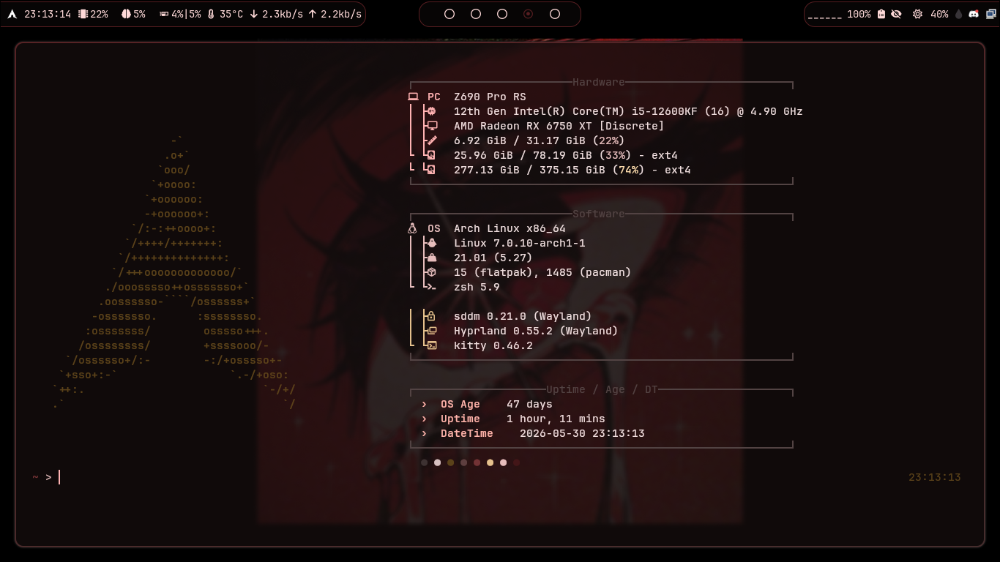
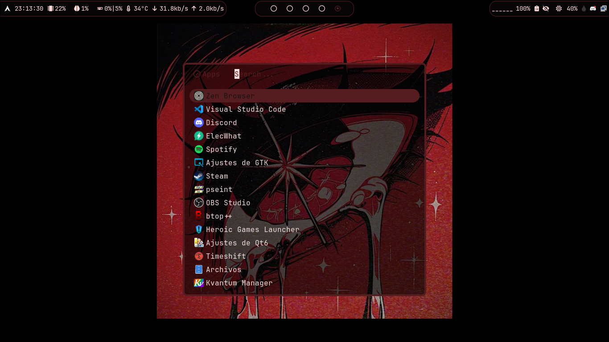
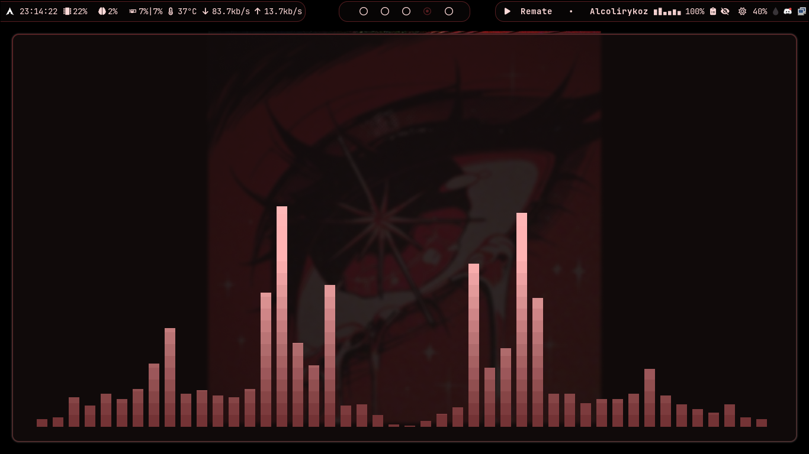
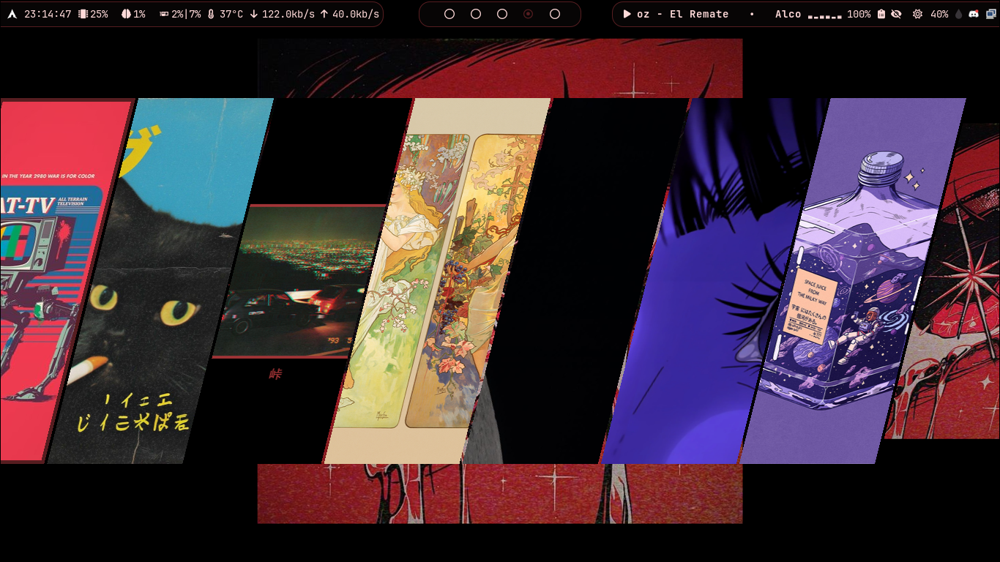
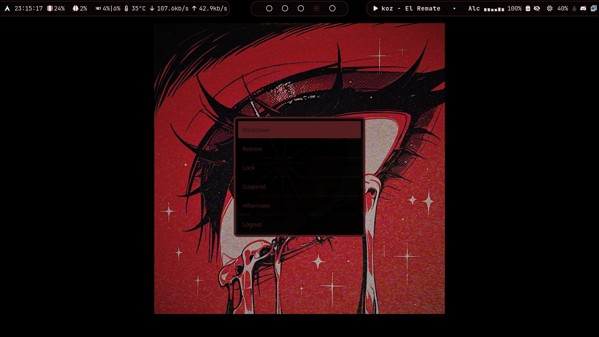

# Hypr-CristOS

[](https://github.com/Cristioro/Hypr-CristOS/actions/workflows/lua-config.yml)
[](https://hypr.land)
[](https://wiki.hypr.land/Configuring/)

Dotfiles para **Hyprland + Waybar** con configuración en Lua, tema dinámico con
**Matugen** y selector de wallpapers con **Quickshell**.

## Capturas

| | |
|---|---|
|  |  |
|  |  |
|  |  |

## Características

- Configuración **modular** de Hyprland en Lua (`config/*.lua`), sin `require("hyprland")`.
- Tema global generado desde el wallpaper con **Matugen** (Hyprland, Waybar, Kitty, Rofi, btop, Fastfetch, Quickshell, VS Code, Discord).
- **Waybar** con módulos propios: reproductor, cava, GPU, brillo, portapapeles, cafeína y workspaces.
- **Rueda del ratón sobre los círculos de Waybar** para cambiar de workspace (daemon `evdev`, ver [`docs/ws-scroll-daemon.md`](docs/ws-scroll-daemon.md)).
- **Cafeína** (`caffeine.sh`) para inhibir idle/suspensión, con estado en Waybar y en el Centro de control.
- Selector visual de wallpapers **hyprquickpaper** (`SUPER + W`).
- **CI** que valida los módulos Lua con un sandbox de Hyprland, shellcheck y sintaxis Python.
- Overrides por máquina en `config/hosts/<hostname>.lua`.
- **Arranque idempotente** de la sesión: `scripts/session-start.sh` + la unidad
  `systemd --user` `hypr-session.service`, que arranca waybar, mako, hypridle,
  wallpaper, portapapeles y el daemon del scroll aunque Hyprland recargue la
  config tarde (por el bootstrap `.conf`).

## Instalación

Requisitos previos: Hyprland 0.57+ y los paquetes de la sección
[Dependencias](#dependencias).

```bash
git clone https://github.com/Cristioro/Hypr-CristOS.git
cd Hypr-CristOS

./install.sh --dry-run   # ver qué hará
./install.sh             # backup + copia + hook de git + recarga de Hyprland
```

`install.sh` hace backup de las configuraciones que va a reemplazar en
`~/.config/backup-install-<fecha>/`, copia `Dotsfile/` a `~`, da permisos de
ejecución y recarga Hyprland.

### Mantener el repo sincronizado

La fuente de verdad es tu `~/.config`. Para volcar los cambios funcionales al
repo sin arrastrar wallpapers ni archivos personales:

```bash
./sync.sh --dry-run   # ver diferencias
./sync.sh             # copiar al repo
```

## Estructura

```
Dotsfile/.config/hypr/
├── hyprland.lua          # raíz: require de config/*
├── hyprland.conf         # bootstrap que carga hyprland.lua
├── hypridle.conf
├── hyprlock.conf
├── config/
│   ├── variables.lua     # mainMod, apps
│   ├── env.lua           # variables de entorno
│   ├── autostart.lua     # daemons y apps al iniciar
│   ├── monitors.lua      # monitores (plug & play)
│   ├── settings.lua      # decoración, animaciones, input
│   ├── keybinds.lua      # atajos
│   ├── colors.lua        # GENERADO por matugen (módulo M)
│   └── hosts/            # overrides opcionales por máquina
├── scripts/              # session-start, cafeína, capturas, grabación, wallpaper…
└── hyprlock/             # arte y nowplaying
```

La unidad `Dotsfile/.config/systemd/user/hypr-session.service` llama a
`session-start.sh` (idempotente, con lock) al activarse
`graphical-session.target`. `install.sh` la activa con
`systemctl --user enable --now`; así el escritorio arranca completo incluso si
Hyprland carga la configuración Lua después del evento `hyprland.start`.

`scripts/hooks/pre-commit` protege el repo: bloquea cambios en `Wallpapers/`,
cachés y archivos personales, y valida los scripts. `install.sh` lo activa con
`git config core.hooksPath scripts/hooks`.

## Herramientas

### Matugen

Genera temas y configuraciones desde plantillas a partir del wallpaper.

Componentes sincronizados:

- Hyprland (`config/colors.lua`)
- Waybar (`colors.css`)
- Kitty, Rofi, btop, Fastfetch
- Quickshell (para hyprquickpaper)
- Visual Studio Code (tema [Matugen Theme](https://github.com/cristobal-rojas/matugen-vscode-theme))
- Discord (BetterDiscord y otros clientes)

Plantilla de Hyprland: `Dotsfile/.config/matugen/templates/hyprland.lua`
Configuración: `Dotsfile/.config/matugen/config.toml`

### Cafeína (`caffeine.sh`)

Mantiene la pantalla encendida e inhibe el idle/suspensión.

- Inhibidor de logind (`idle` + `sleep`, modo `block`)
- Notificaciones al activar/desactivar
- Estado e interruptor en Waybar y en *Centro de control → Pantalla*
- Atajo: `SUPER + SHIFT + CAPS_LOCK`

```bash
~/.config/hypr/scripts/caffeine.sh toggle
~/.config/hypr/scripts/caffeine.sh status
```

### hyprquickpaper (Quickshell)

Selector visual de wallpapers con miniaturas automáticas, extracción de frames
de vídeo con `ffmpeg` y sincronización de color con Matugen.

- `SUPER + W` → abre el selector

Ubicación: `Dotsfile/.config/quickshell/hyprquickpaper/`

### ws-scroll-daemon

Daemon `evdev` que hace que la rueda cambie de workspace solo sobre los
círculos de Waybar, con un cambio por notch. Documentación completa en
[`docs/ws-scroll-daemon.md`](docs/ws-scroll-daemon.md).

## Dependencias

### Hyprland (pacman)

```bash
pacman -S hyprland hypridle hyprlock hyprpicker hyprshot hyprshutdown hyprsunset
```

Cursores dinámicos con hyprpm:

```bash
hyprpm add https://github.com/virtcode/hypr-dynamic-cursors
hyprpm enable dynamic-cursors
```

### Cafeína

Usa `systemd-inhibit` (viene con systemd). Alternativa: `caffeine` o
`caffeine-ng` desde chaotic-aur.

### Waybar (yay)

```bash
yay -S ttf-arphic-extra ttf-jetbrains-mono-git waybar-git waybar-module-pacman-updates-git wttrbar
```

GPU usage:

```bash
cargo install gpu-usage-waybar
```

### hyprquickpaper (Quickshell)

```bash
yay -S quickshell ffmpeg mpvpaper awww
```

### Rofi

```bash
pacman -S rofi cliphist
```

### Sync de workspaces con la rueda

```bash
pacman -S python-evdev jq
sudo usermod -aG input "$USER"   # cerrar sesión y volver a entrar
```

## Contribuir

- Antes de commitear: `./sync.sh --dry-run` y `./install.sh --dry-run`.
- El hook de git valida scripts y bloquea `Wallpapers/` y archivos personales.
- La CI debe quedar en verde (Lua sandbox + shellcheck + Python).

## Créditos

Dotfiles **modificados con cariño del trabajo original de
[Cristioro](https://github.com/Cristioro)**. Gracias por la base y por
mantenerla viva.

Además:

- **Rofi themes:** https://github.com/zhaleff/BlackNode/tree/master
- **hyprquickpaper:** https://github.com/iamsurjog/hyprquickpaper
- **BreezeX theme for hyprcursor:** Njobe

> `Wallpapers/` contiene los fondos del proyecto original. No se aceptan
> cambios ahí: los fondos personales no se suben al repositorio.
